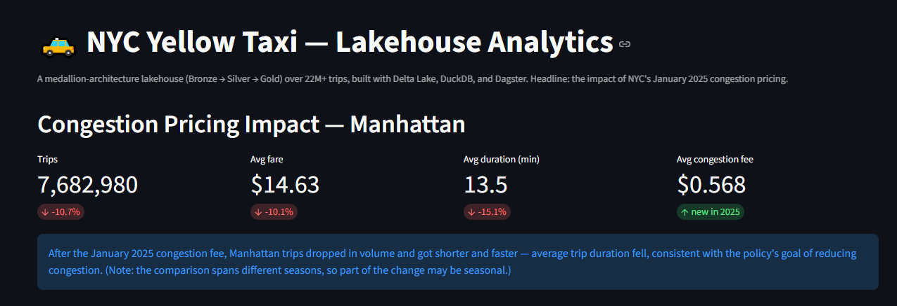
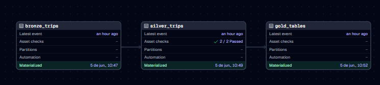
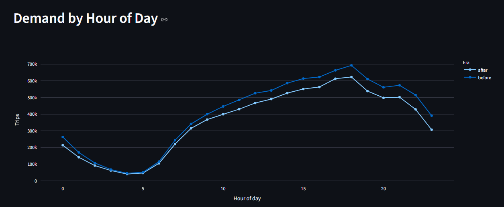
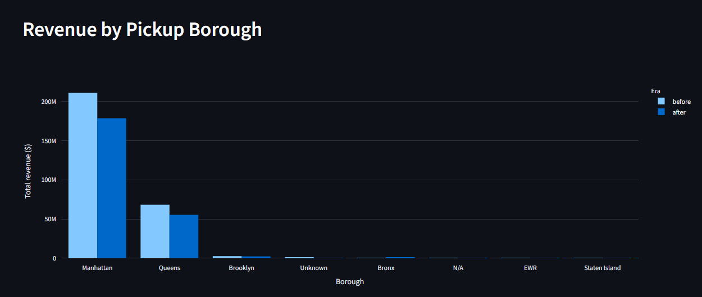
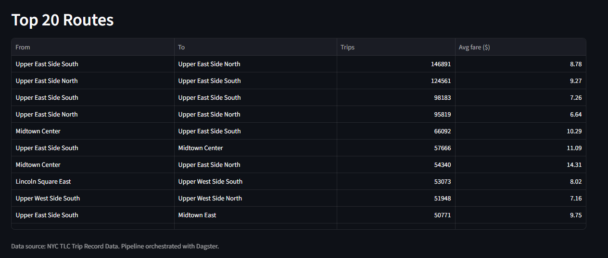

# 🚕 NYC Yellow Taxi — Medallion Lakehouse

[](https://github.com/DiegoTDDD/nyc-taxi-lakehouse/actions/workflows/tests.yml)
[](https://github.com/DiegoTDDD/nyc-taxi-lakehouse/actions/workflows/howto-check.yml)
[](LICENSE)

**Problem.** In January 2025 New York City started charging a congestion fee for driving into Manhattan's central business district. Answering whether it changed taxi use means combining months of trip files whose schema changes mid-way, removing about a fifth of the records as invalid, and trusting the aggregates that come out.

**Solution.** A medallion lakehouse (Bronze → Silver → Gold) in Delta Lake over 22.3 million trips, transformed with DuckDB, orchestrated by Dagster, with ten data-quality checks that stop bad data before it reaches the numbers. A Streamlit dashboard presents the result.

- **Live dashboard:** [nyc-taxi-lakehouse.streamlit.app](https://nyc-taxi-lakehouse.streamlit.app)
- **Design decisions:** [`docs/adr/`](docs/adr/README.md)

---

## The business question

In January 2025, NYC introduced a congestion fee for trips into the Manhattan central business district — visible in the data as a brand-new `cbd_congestion_fee` column that exists only from 2025 onward. By ingesting six months of data straddling the rollout (Oct 2024 – Mar 2025), this project asks: **did the policy change how people use taxis in Manhattan?**

**What the data shows (Manhattan pickups, before vs after):**

| Metric | Before | After | Change |
|---|---|---|---|
| Trips | 8,606,791 | 7,682,980 | −10.7% |
| Avg fare | $16.27 | $14.63 | −10.1% |
| Avg trip duration | 15.9 min | 13.5 min | −15.1% |
| Avg congestion fee | $0.00 | $0.57 | new in 2025 |

After the fee, Manhattan trips dropped in volume and the remaining trips became **shorter and faster** — average duration fell by ~15%, consistent with the policy's stated goal of reducing congestion. (Caveat: the comparison spans different seasons, so part of the shift may be seasonal rather than purely policy-driven — a deliberately honest framing.)



---

## Architecture

A medallion lakehouse in open **Delta Lake** format, orchestrated as a graph of assets in **Dagster**.

```
TLC Parquet files  ──▶  Bronze  ──▶  Silver  ──▶  Gold  ──▶  Streamlit dashboard
                       (raw,      (clean,       (business
                        faithful)  enriched)     aggregates)
```

- **Bronze** — raw TLC Parquet ingested faithfully, with ingestion metadata (`_ingested_at`, `_source_file`). Handles **schema evolution**: the 2025 files add `cbd_congestion_fee`, merged into the table while 2024 rows stay null. *22,346,537 rows.*
- **Silver** — cleaned and validated (removed non-positive fares, zero/absurd distances, inverted timestamps, invalid passenger counts), enriched by joining the TLC taxi-zone lookup to translate location IDs into real borough/zone names, and standardized the congestion fee across both schemas. *18,165,564 rows (~18.7% removed as invalid).*
- **Gold** — small, business-ready aggregate tables: congestion impact, demand by hour, revenue by borough, top routes.

### Orchestration & data quality (Dagster)

The pipeline is a graph of three assets with declared dependencies; Dagster resolves the execution order. All the logic lives in `pipeline.py`, and the assets call it ([ADR 0004](docs/adr/0004-one-pipeline-module.md)). Ten **asset checks** measure every layer after it is written. The critical ones are **blocking**: if Silver contains a non-positive fare, an impossible duration, a null key, or loses more than 30% of Bronze, the run stops before Gold is built ([ADR 0002](docs/adr/0002-quality-as-blocking-asset-checks.md)).

| Layer | Checks |
|---|---|
| Bronze | not empty (blocking) · the 2025 schema change arrived |
| Silver | positive fares and totals · durations 1 min to 24 h · values within the cleaning rules · no null keys · reconciles with Bronze (all blocking) · zone lookup coverage |
| Gold | hourly trips add up to Silver's row count · both eras present |



---

## Selected results

**Demand by hour of day** — overlapping daily curves, with the post-fee era consistently slightly lower at peak hours.



**Revenue by pickup borough** — Manhattan dominates, with a visible drop after the fee.



**Top routes** — short intra-Manhattan hops (Upper East Side, Midtown) lead by volume.



---

## Design decisions

| Decision | Why |
|---|---|
| [Delta Lake + DuckDB, not Spark](docs/adr/0001-delta-lake-and-duckdb.md) | 22 million rows fit one machine; Delta brings schema evolution and safe overwrites |
| [Blocking asset checks](docs/adr/0002-quality-as-blocking-asset-checks.md) | Bad Silver never reaches the published numbers |
| [Delta read through `deltalake`, not DuckDB's extension](docs/adr/0003-read-delta-without-the-duckdb-extension.md) | No runtime download, so the pipeline and its tests work offline |
| [One pipeline module](docs/adr/0004-one-pipeline-module.md) | Removed the second copy of the SQL that Dagster used to run |
| [Dashboard reads a Parquet export](docs/adr/0005-dashboard-reads-a-parquet-snapshot.md) | The free host cannot run the pipeline. A monthly check keeps the export in line with the real data |

---

## Limitations

- **Seasons overlap with the policy.** The before (Oct to Dec) and after (Jan to Mar) periods differ in season as well as in pricing. The same months a year earlier would separate the two effects.
- **Yellow taxis only.** Ride-hailing and green taxis also absorb demand, and they are not included.
- **Single machine.** Comfortable at this size. Billions of rows would need Spark or a warehouse.
- **The public dashboard shows the last exported run,** not a live pipeline.

---

## Tech stack

| Layer | Tool |
|---|---|
| Storage format | Delta Lake (`deltalake` / delta-rs) |
| Query engine | DuckDB over Arrow datasets read by `deltalake` (Parquet for the deployed app) |
| Orchestration | Dagster (assets + asset checks) |
| Dashboard | Streamlit + Plotly |
| Language | Python |

---

## Running it locally

```bash
# 1. Create and activate a virtual environment
python -m venv .venv
source .venv/Scripts/activate        # Windows (Git Bash)
# .venv\Scripts\Activate.ps1         # Windows (PowerShell)
# source .venv/bin/activate          # macOS / Linux

# 2. Install dependencies
pip install -r requirements.txt

# 3. Download the raw data (~360 MB)
python src/nyc_taxi_lakehouse/download_data.py
python src/nyc_taxi_lakehouse/download_zones.py

# 4. Run the pipeline via Dagster
dagster dev -f src/nyc_taxi_lakehouse/definitions.py
# then open http://localhost:3000 and click "Materialize all"

# 5. Export the Gold tables to Parquet for the dashboard
python src/nyc_taxi_lakehouse/export_gold.py

# 6. Launch the dashboard
streamlit run dashboard.py

# Tests (no data download needed)
pip install -r requirements-test.txt
pytest
```

## Automated checks

- **Tests** (`tests.yml`) run on every push and pull request: `ruff` (type hints required in the pipeline, and no `print` there) and 7 tests. They run Bronze, Silver and Gold on ten hand-made trips across the 2024/2025 schema change (cleaning rules, zone join, congestion era, every Gold aggregate) and materialize the Dagster graph with all ten checks. One test plants a negative fare and verifies that the blocking check stops the run before Gold is written.
- **How-to-run check** (`howto-check.yml`) runs the README steps on the real data every month: it downloads 360 MB, materializes every asset and check, verifies the row counts quoted above, and compares the exported Gold tables with the committed ones.
- **Windows check** (`windows-check.yml`) installs and smoke-tests the project on Windows.
- **Security audit** (`security-audit.yml`) audits every `requirements*.txt` with `pip-audit` whenever dependencies change and every Monday. It fails only when a vulnerable package has a fixed version available.
- **App health** (`app-health.yml`) opens the [live app](https://nyc-taxi-lakehouse.streamlit.app) in a real browser after each push and once a day (waking it if it was asleep) and fails if the app shows an error.

## Project layout

```
nyc-taxi-lakehouse/
├── src/nyc_taxi_lakehouse/
│   ├── pipeline.py        # Bronze ingestion, Silver rules + SQL, Gold queries, quality helpers
│   ├── definitions.py     # Dagster assets, the Lakehouse resource and the ten asset checks
│   ├── bronze.py / silver.py / gold.py   # the same steps without Dagster
│   ├── download_data.py   # the six TLC monthly files
│   ├── download_zones.py  # the taxi zone lookup
│   └── export_gold.py     # Gold -> data/gold_parquet/ for the dashboard
├── scripts/exploration/   # one-off scripts used while building the layers
├── tests/                 # pytest on a ten-trip lakehouse
├── dashboard.py           # Streamlit app (reads data/gold_parquet/)
├── data/gold_parquet/     # committed Gold export for the deployed dashboard
├── docs/adr/              # architecture decision records
├── pyproject.toml         # project metadata, pytest and ruff settings
├── requirements.txt       # pinned pipeline + dashboard dependencies
└── requirements-test.txt  # requirements.txt + pytest
```

## Data source

[NYC TLC Trip Record Data](https://www.nyc.gov/site/tlc/about/tlc-trip-record-data.page) — Yellow Taxi, October 2024 through March 2025. Raw data is not versioned in this repository.
